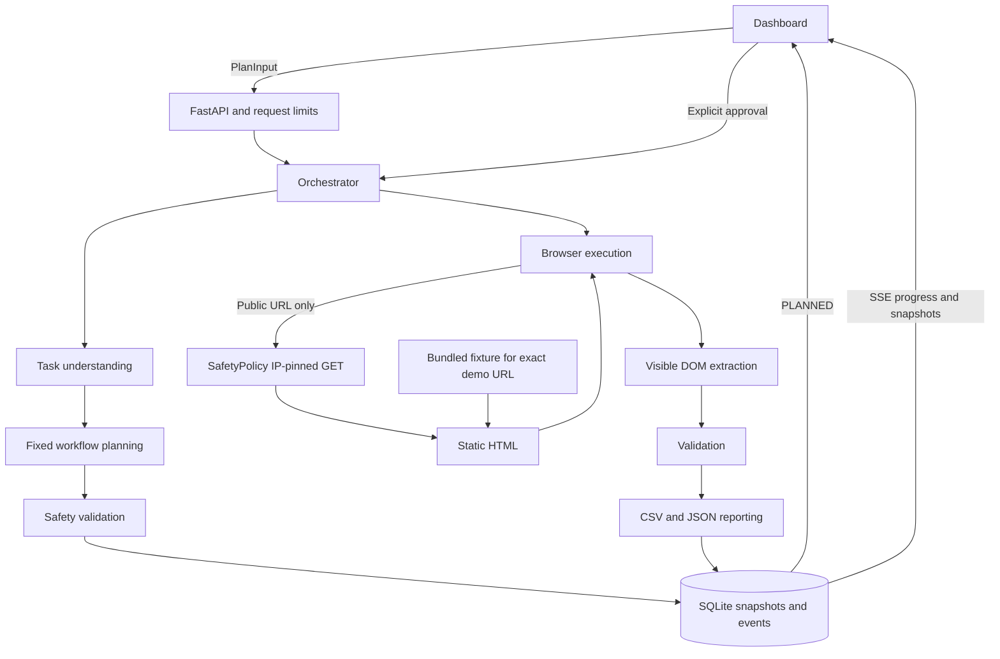
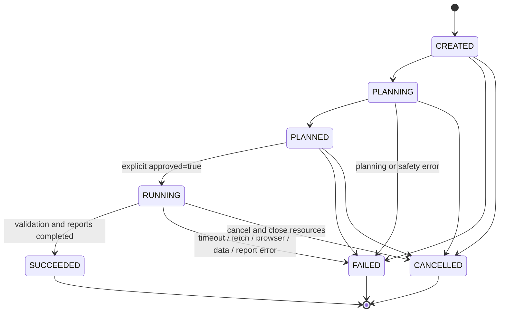

# Architecture and API contract

Sanyojan is a single-process, local-first workflow application: React/TypeScript/Vite dashboard, FastAPI backend, SQLite snapshots/events, and Playwright Chromium for restricted DOM reading. `create_app(settings=None, browser=None, adapter=None)` in `backend/sanyojan/app.py` supports dependency injection; `app = create_app()` is the Uvicorn entry point. The backend mounts `frontend/dist` at `/` if that directory exists at app creation.

## Eight logical agent roles

These are cooperating Python components, not eight independently running language models. Six have `Agent` class names; safety and orchestration complete the eight roles.

| Role / actual implementation | Responsibility | Boundary / limitation |
| --- | --- | --- |
| Task understanding — `planning.TaskUnderstandingAgent` | Calls an injected `UnderstandingAdapter` or the default `DeterministicAdapter`; revalidates `TaskSpec` within 20 seconds. | Default is a limited grammar, not general natural-language reasoning. Cannot change URL or task type. |
| Workflow planning — `planning.WorkflowPlanningAgent` | Builds a schema-validated five-step `Plan` with expected results, validation rules, low risk, and timeout metadata. | Fixed action order and deterministic mode; no model-generated executable plan. |
| Safety — `safety.SafetyPolicy` | Validates URLs/plans, resolves public DNS, performs bounded IP-pinned static GETs, and checks every redirect. | Exact hostname allowlist; one page, same-host redirects only. |
| Browser execution — `browser.BrowserExecutionAgent` | Supplies fixture/fetched HTML through one intercepted navigation; reads title and invokes extraction. | Scripts, service workers, downloads, and all other page requests blocked. No clicks, forms, logins, or screenshots. |
| Extraction — `extraction.ExtractionAgent` | Reads supported visible DOM profiles using locators, capped record count and 2,000-character field values. | No arbitrary selectors or pagination. Books profile provides title/price; inspection reads title/body only. |
| Validation — `validation.ValidationAgent` | Normalizes whitespace/prices, marks missing values and duplicates, adds URL/time provenance and warnings. | Every requested field is required. No invented values, currency conversion, or guarantee that source claims are true. |
| Reporting — `reporting.ReportingAgent` | Writes real task-scoped CSV and versioned JSON files with atomic replacement per file. | CSV formula escaping and UUID-contained paths; no transactional guarantee across the two files. |
| Orchestration — `orchestrator.Orchestrator` | Requires approval, enforces transitions/concurrency/deadlines, owns workers, persists progress via `Store`, handles cancellation. | In-process workers; no distributed queue, automatic retries, or multi-worker coordination. |

## End-to-end flow



The fixture is **only** `https://demo.sanyojan.test/products`. It is not a listening HTTP service and does not bypass private-address checks for other URLs. Public HTML is fetched outside Chromium by the safety transport. Chromium receives bytes through a route fulfillment, with JavaScript disabled and all subrequests aborted. Public responses are restricted to uncompressed HTML and the configured size/deadline limits.

`extraction` and `report` share the same extraction/reporting pipeline. `inspection` returns a single page record with requested title/description fields. Supported listing profiles are `[data-record]` / `[data-field]`, `books.toscrape.com`'s `article.product_pod`, and visible schema.org Product `itemprop` fields. Hidden metadata is not a fallback. A successful workflow may contain invalid records: `SUCCEEDED` means the pipeline and reports completed, not that every value passed validation.

## State machine and errors



The allowed transitions are defined in `schemas.TRANSITIONS`; terminal states cannot execute again. URL syntax and understanding are checked before task creation, so early rejection may create no history item. After persistence, planning/safety failures mark the task `FAILED`. Execution-time errors persist a failure result with no records/reports, a failed-step number, duration, and a sanitized error. Earlier planning failures and cancellation may have no result.

On startup, `Store.recover()` marks persisted `CREATED`, `PLANNING`, and `RUNNING` tasks `FAILED` as interrupted; `PLANNED` and terminal tasks remain. A graceful shutdown cancels owned workers. Browser teardown is awaited even during repeated cancellation. Retrying a terminal workflow means creating and approving a new plan.

## HTTP API

All paths below are backend paths (development Vite proxies `/api`). Request/response schemas are in `schemas.py` and `/openapi.json`. Task IDs in routes must parse as UUIDs. JSON models reject unknown properties.

| Method and endpoint | Success | Important other statuses / behavior |
| --- | --- | --- |
| `GET /api/health` | `200` `Health` | `status`, `version`, `planner_mode: deterministic`, `browser_available`; HTTP 200 alone does not prove Chromium readiness. |
| `POST /api/tasks/plan` | `201` `Task`, normally `PLANNED` | `400` unsupported instruction/policy/DNS; `422` invalid input; `429` history full/rate; `502` invalid or timed-out adapter response. No browser workflow runs. |
| `GET /api/tasks?limit=50&offset=0` | `200` `Task[]`, newest first | `limit` 1–100; `offset` 0–10000; `422` outside bounds. History omits logs and record bodies; open a task for details. |
| `GET /api/tasks/{id}` | `200` full `Task` | Includes persisted logs and any result. `404` unknown task. |
| `POST /api/tasks/{id}/execute` | `202` `Task` in `RUNNING` | Body **`{"approved":true}`**; `422` missing/false approval; `409` wrong state/already executed; `429` browser capacity; `503` Chromium unavailable. Safety is checked again. |
| `POST /api/tasks/{id}/cancel` | `200` `Task` | No body needed. Cancels nonterminal work and waits for cleanup; already-terminal tasks are returned unchanged. |
| `GET /api/tasks/{id}/results` | `200` `Result` | `409` when no result exists. A `FAILED` execution may have an empty failure result; inspect status and `failed_steps`. |
| `GET /api/tasks/{id}/reports/{format}` | `200` downloadable file | `format` is `csv` or `json`; `400` other format; `409` task not successful; `404` missing task/report. |
| `GET /api/tasks/{id}/events?after=0` | `200` `text/event-stream` | `400` invalid `Last-Event-ID`; `404` unknown task; `422` invalid `after`. Durable replay contract below. |

Common errors: `422` for request-schema/UUID validation, `404` for unknown tasks, `403` for unapproved POST origins, `413` above a 16 KiB POST body, `408` for body-read timeout, `415` for a non-JSON nonempty POST body, `429` for mutation rate limits, and sanitized `500` for unexpected failures. Trusted-host rejection is middleware-level HTTP 400 and need not have the JSON error envelope.

Application errors have this shape; validation errors additionally contain field/message `details` without raw inputs:

```json
{"error":{"code":"INVALID_TRANSITION","message":"Only an approved PLANNED task can execute, exactly once."}}
```

Planning body example:

```json
{
  "instruction": "Extract product titles and prices and generate CSV and JSON reports",
  "target_url": "https://demo.sanyojan.test/products",
  "task_type": "extraction",
  "fields": ["title", "price"]
}
```

`instruction` is 10–2,000 characters; `target_url` defaults to the fixture; `task_type` is `extraction`, `inspection`, or `report`; optional `fields` must be unique supported names. A plan always has five numbered actions, low risk, expected results, validation rules, and timeout metadata. Execution is controlled by application code, not by interpreting step strings as commands. The whole-task deadline and Playwright action/navigation timeout are enforced; step timeout metadata is not a separate timer around every synchronous stage.

### Retry semantics

Planning POSTs are not idempotent and have no idempotency key. If a response is lost, inspect history before resubmitting. Execution is accepted once from `PLANNED`, with a state recheck after asynchronous safety validation; repeated execution is rejected. A capacity rejection leaves the task planned so the user can retry later. Cancellation is terminal-idempotent. Read endpoints can be retried; SSE replay does not rerun work.

## SSE contract

- Connect to `/api/tasks/{id}/events`. The stream begins with **`retry: 2000`**, advertising a two-second native reconnect delay.
- Cursor precedence: **`Last-Event-ID` header**, otherwise query `after`, otherwise `0`. The effective cursor must be a nonnegative integer of at most 18 digits. Only stored events with `id > cursor` for that task are replayed.
- Each event is named **`progress`**, regardless of its JSON `type`. IDs are SQLite-global monotonically increasing integers, so a task's IDs may have gaps. Treat them as cursors, not a per-task count.
- JSON data has `id`, `task_id`, UTC `timestamp`, `type` (`state`, `step`, `warning`, `error`, `log`), `message`, `status`, and integer **`progress` 0–5** (not a percentage).
- The server polls stored events every 250 ms and sends a comment heartbeat about every ten seconds while nonterminal. Terminal events are drained before the stream closes. A new terminal-task connection replays eligible events, then closes.
- Headers include `Cache-Control: no-cache` and `X-Accel-Buffering: no`. An intervening proxy must preserve streaming and disable buffering.

Example wire framing (each event ends with a blank line):

```text
retry: 2000

id: 12
event: progress
data: {"id":12,"task_id":"4613ba8d-47e4-473d-b366-0dd06165f056","timestamp":"2026-10-19T12:00:00+00:00","type":"step","message":"Loaded the static page with all external requests blocked.","status":"RUNNING","progress":1}

: heartbeat

```

The frontend retains the same `EventSource` across transient failures so native reconnect preserves `Last-Event-ID`, deduplicates logs by ID, and reconciles task snapshots/results. Recovery checks run at four-second intervals when needed. A new stream can replay older events safely; consumers should deduplicate. Close the client stream on a terminal status to avoid native reconnection loops after normal EOF. SSE only announces progress/state; fetch task/results endpoints for complete records and reports.

## Persistence and deployment shape

`Store` writes a task snapshot and its event together in one SQLite transaction (WAL mode). The default database is `data/tasks.sqlite3`; reports are separate files under `data/reports`. Event IDs remain durable across restarts. Report JSON is `{schema_version: 1, metadata: {task_id, generated_at}, result: ...}`; CSV contains requested fields plus `source_url`, `extracted_at`, `valid`, and `warnings`.

Defaults allow two concurrent workers and 1,000 stored tasks; there is no queue, pruning, or data-deletion API. Concurrency/rate state is process-local. Run one Uvicorn worker and one service instance per data directory. Back up database/WAL files and reports together with the service stopped.

Development uses Vite on 5173 and FastAPI on 8000. Production builds the frontend once and serves UI/API on 8000 from the same backend. Compose provides persistent writable data and loopback binding; external authentication and network isolation are deployment responsibilities. See [README](../README.md) for exact commands and [security](security.md) for boundaries.
